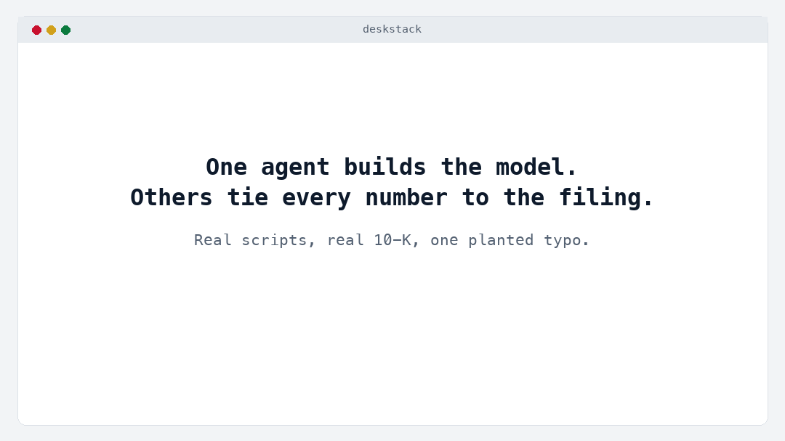

# deskstack

**AI-built models get numbers wrong. deskstack checks every one against the filings.**

[](https://github.com/joaquimmj/deskstack/actions/workflows/ci.yml)
[](evals/README.md)
[](LICENSE)
[](plugins/deskstack)
[](https://star-history.com/#joaquimmj/deskstack&Date)



- **Free data with a source, US and Europe.** Every figure comes with its filing, period and link. Missing stays
  `null`, never an estimate.
- **Independent reviewers.** One agent builds the model. Others tie every number to the filing and review the
  model. They report; they never edit.
- **Nothing ships without your OK.** The final file is exported only after you approve it in your own words.

[Website](https://joaquimmj.github.io/deskstack/) · [Tutorial](docs/TUTORIAL.md) · [Tutoriel (FR)](docs/TUTORIEL.md)

> **Public beta.** The hosted connector is online at `https://deskstack.deskstack-server.workers.dev/mcp`. Feedback
> and issues are welcome.

## Install in 30 seconds

1. **Data:** in Claude, open **Settings → Connectors → Add custom connector** and paste
   `https://deskstack.deskstack-server.workers.dev/mcp`, with no sign-in. You can also run your own copy
   ([self-hosting](docs/SELF_HOSTING.md)).
2. **Roles:** open **Customize → Plugins → Add marketplace**, paste `https://github.com/joaquimmj/deskstack`, then
   install **deskstack**. In Claude Code: `/plugin install deskstack --marketplace joaquimmj/deskstack` (2.1.275+).
3. **Try it:** `/deal-team Apple quick-dcf`.

**Check a workbook from a terminal** (soon, once the package is on PyPI):

```bash
pipx run deskstack-check model.xlsx
```

Until then, the same checker runs from a clone, with openpyxl installed: `python -m deskstack_check model.xlsx` in
`checker/` ([checker/README.md](checker/README.md)).

The tutorial walks through a first reviewed DCF in about 10 minutes: [English](docs/TUTORIAL.md) ·
[français](docs/TUTORIEL.md).

## What it catches

Real errors from the [benchmark](#benchmark): Claude with web search only, building a DCF or a comps table. Each was
read by hand against the filing.

| Error | Real example | What catches it |
|---|---|---|
| Last twelve months a quarter late | FedEx, Fortinet, Motorola Solutions: an aggregator's "TTM" to June, after the September 10-Qs were filed (15 figures) | `/associate`: `verify_value` says *Stale* and gives the latest twelve months |
| A quarter written as the year | Boeing net income: the fourth quarter (8,220) as the full year (2,235) | `/associate`: mismatch against the filed annual figure |
| Share count derived or from the wrong period | Boeing, Pfizer, GE diluted shares: net income ÷ EPS, a six-month count, a Q1 count | `/associate`: mismatch, and a flag when diluted shares are more than 10% from the cover page |
| Non-GAAP or segment figure for the group | GE "adjusted revenue"; Stellantis D&A for industrial activities only | `/associate`: mismatch against the group's filed line |
| Figure from an aggregator or Wikipedia | Cisco and Verizon operating income; Schneider operating income, rounded | `/associate`: mismatch, with the filed value and its source |
| Estimate typed as a filed figure | Netflix capex as operating cash flow minus free cash flow | `/associate`: mismatch; `/vp-review` rule DS016 also flags a figure labelled as an estimate with no filing cited |
| Placeholder left at 0 | Cigna, CVS and Humana in UnitedHealth's comps, labelled "NOT FOUND" (7 figures) | `/vp-review` rule DS016: a typed 0 labelled as not found |

`verify_value` also names the usual causes of a mismatch: wrong scale, opposite sign, another period, another line
item, another currency, two digits swapped. The 20 model rules are listed in [checker/README.md](checker/README.md).

## Benchmark

How many reported figures in an AI-built model are wrong, with and without deskstack. 50 companies (35 US, 15
European), a DCF and a comps table each, three setups, Claude Sonnet 5.5. Every figure the scorer called wrong was
then read by hand against the filing.


- **DCF:** with web search only, 20 of 573 reported figures were wrong (3.5%, in 12 of 50 models). With deskstack's
  data: 0, at a third of the cost ($0.07-0.10 vs $0.23 per model) and 2-3× faster
  ([analysis](bench/results/2026-11-09T09-25-07-305Z/ANALYSIS.md)).
- **Comps:** with web search only, 16 of 445 were wrong (3.6%). 15 of them were twelve-month figures a quarter out of
  date. 7 more were left as 0 placeholders. With deskstack's data: 0 of 1,021, at a third of the cost ($0.17-0.22 vs
  $0.56 per table) and 3-5× faster ([analysis](bench/results/2026-11-09T13-04-05-468Z/ANALYSIS.md)).

**Read the 0 with care.** It is partly by construction: setups B and C read the same data the scorer checks against.
That data is checked independently by the golden set and a nightly re-read with other XBRL parsers
([Accuracy](#accuracy)). Each analysis also lists what the run found wrong in deskstack itself, and what was fixed.
The runner, the frozen company set and the method are in [bench/](bench/README.md). The chart is drawn from the
analyses by `server/bench/chart.ts`.

## The roles

| Command | Role | What it does |
|---|---|---|
| `/analyst` | Builder | Pulls cited data, agrees the assumptions with you, builds the workbook (blue inputs, a Sources sheet, a disclaimer) |
| `/associate` | Tie-out | Checks every typed number against the filing with `verify_value`, and flags wrong scale, sign, period, line item, currency or a stale twelve months |
| `/vp-review` | Model review | Runs 20 deterministic checks (hardcodes, broken rows, balance sheet, terminal value, placeholders, plugs…), then compares the assumptions with filed history |
| `/md-redteam` | Challenge | Sensitivities, the assumptions the market price implies, the top five objections |
| `/compliance` | Hygiene | Disclaimer, citations, dated user inputs, no sign of non-public information, no buy/sell language |
| `/sign-off` | Human gate | One page of every check. A signed copy is exported only after you approve in your own words |
| `/deal-team` | Orchestrator | Runs the whole sequence |

Reviewers report; they never edit. In Claude Code and Cowork, they run as separate agents that don't see the
builder's reasoning. Details: [docs/ROLES.md](docs/ROLES.md).

## Works with Anthropic's financial-analysis plugin

Built your model with Anthropic's `financial-analysis` plugin? Run `/associate`, `/vp-review`, `/md-redteam` and
`/sign-off` on that workbook as it is. `/vp-review` merges the plugin's `audit-xls` findings with its own and marks
the ones both raised. Details: [docs/ROLES.md](docs/ROLES.md#companion-mode).

## Data sources and coverage

| Data | Source | Coverage |
|---|---|---|
| Financial statements (US) | SEC EDGAR XBRL (10-K, 10-Q, 20-F) | US-listed companies, including IFRS foreign filers; annual years plus LTM |
| Financial statements (Europe and UK) | ESEF and UKSEF annual reports via [filings.xbrl.org](https://filings.xbrl.org) | 159 large issuers in 14 countries: 55 UK listed companies, and 104 issuers in France, the Netherlands, Spain, Italy, Finland, Belgium, Denmark, Sweden, Norway, Austria, Portugal, Ireland and Luxembourg; annual |
| Risk-free rates | U.S. Treasury par yield curve; ECB euro area par yields | Daily, 1 month to 30 years |
| Exchange rates | ECB reference rates | 30+ currencies, latest, on a date or as a period average |
| Valuation inputs | Aswath Damodaran's public datasets (NYU Stern) | ERP and country risk by country; betas and cost of capital by industry |

Every value carries its source: filing, accession or report, period. The 8 tools are documented in
[docs/TOOLS.md](docs/TOOLS.md). Terms and attribution for each source are in [docs/DATA_SOURCES.md](docs/DATA_SOURCES.md).

## Accuracy

- **The golden set:** 238 questions with known answers from the filings. It covers:
  - US issuers and IFRS 20-F filers;
  - at least 10 questions for each of the 14 European countries covered, the UK included, each answer read by
    Arelle from the published report;
  - a bank;
  - restatements and a stock split;
  - 52/53-week years, and fiscal years ending in January, February, March, June and September.
- **Every push:** every question must pass through the real tools on recorded data. Today: 100%.
- **Nightly:** an independent re-read of each answer from the filing itself, with edgartools for SEC and Arelle for
  ESEF. Details: [evals/README.md](evals/README.md).

## Limitations

- No share prices: a market cap needs a price you give.
- No consensus estimates.
- European and UK coverage is partial and annual only. There are no German issuers, because their reports aren't in
  the public ESEF repository. Some UK companies tag no total assets; that line is then `null`.
- IFRS 20-F filers have no LTM.
- Banks and insurers are flagged; EBITDA and EV metrics don't apply to them.
- The benchmark's 0 is partly by construction (see [Benchmark](#benchmark)). It ran on one model, Claude Sonnet 5.5.
- **Reviewers reduce errors but don't replace a human reviewer.** Everything is a draft until you sign it off.

## How it stays free

- **Free hosting:** the server runs on Cloudflare Workers' Free plan, with a daily cap and a per-IP limit.
- **Static snapshot:** SEC data comes from a nightly snapshot served as static files.
- **Self-hosting:** your own copy takes a few minutes and costs nothing ([docs/SELF_HOSTING.md](docs/SELF_HOSTING.md)).
- **Privacy:** the server stores no user data and logs no prompts ([PRIVACY.md](PRIVACY.md)).

## FAQ

**Is it free?** Yes. The data comes from free public sources, and the hosted server runs on free tiers. If the daily
cap is reached, run your own copy.

**Is the 0% real?** The 0 wrong figures are what the hand reading found. But setups B and C read the data the scorer
checks against, so the 0 says the models copied deskstack's figures faithfully. Whether those figures are right is
checked separately, by the golden set and the nightly re-read.

**Does it change my model?** No. Reviewers only report. The analyst applies a fix only when you ask.

**Where does my workbook go?** The workbook checks are scripts in the plugin. They run where Claude runs your skills:
on your machine in Claude Code, in Claude's sandbox in the apps. Only the tool calls reach the deskstack server, which
stores no user data and logs no prompts.

**Can I use a company that isn't covered?** For US-listed companies, coverage follows SEC filings. In Europe,
`company_lookup` says if an issuer isn't covered; `data_status` lists the countries. Missing figures stay `null`.

**Is it investment advice?** No. It checks figures against filings. It never says buy or sell.

**Is it from Anthropic?** No. It is an independent open-source project that runs inside Claude.

## Contributing

You can add a data source, a checker rule, a role, golden questions or benchmark companies. See
[CONTRIBUTING.md](CONTRIBUTING.md).

```bash
cd server && npm ci && npm test           # data server (TypeScript, Cloudflare Worker)
python3 -m pytest checker/tests           # checker and plugin scripts (Python, openpyxl)
```

## Credits

- **SEC XBRL standardization:** first solved by [open-finance-mcp](https://github.com/nathanaelhub/open-finance-mcp)
  by Nathanael Johnson (MIT). deskstack ports it to TypeScript with parity tests.
- **Bundled code:** openpyxl and et_xmlfile (MIT), vendored in the plugin.
- **Third-party data:** SEC EDGAR, XBRL International's filings.xbrl.org, U.S. Treasury, ECB statistics, and Aswath
  Damodaran (NYU Stern).

See [THIRD_PARTY_NOTICES.md](THIRD_PARTY_NOTICES.md).

---

Independent open-source project. Not affiliated with or endorsed by Anthropic. Data may be incomplete or delayed;
verify against the cited filing. Not investment advice. MIT license.

Built by the team behind [Aptence](https://aptence.app).
