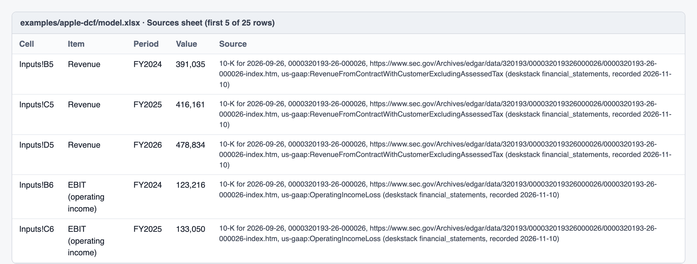
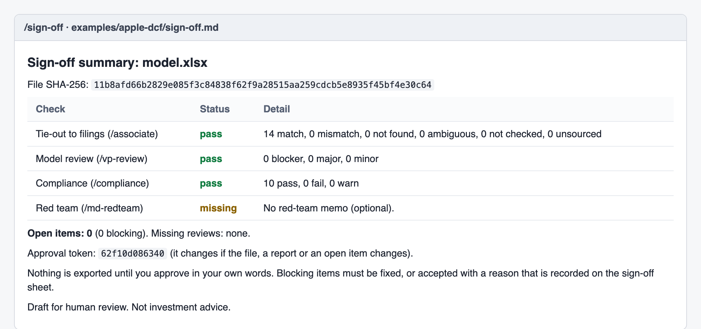
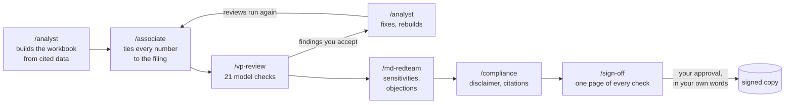

# deskstack

**Claude builds your DCFs and comps from SEC and European filings, and a second agent checks every number against
the filing.** In the benchmark, 0 of 3,230 reported figures were wrong with deskstack, against 36 of 1,018 (3.5%)
with web search only.


[](evals/README.md)
[](https://github.com/joaquimmj/deskstack/actions/workflows/ci.yml)
[](LICENSE)
[](#set-up-in-the-claude-app)

If it saves you a tie-out, a star helps others find it.

[Website](https://joaquimmj.github.io/deskstack/) · [Examples](examples/README.md) · [Tutorial](docs/TUTORIAL.md) · [Tutoriel (FR)](docs/TUTORIEL.md)

> **Public beta.** The hosted connector is online at `https://deskstack.deskstack-server.workers.dev/mcp`. Feedback
> and issues are welcome.

## Why

With web search only, Claude fills gaps with numbers that aren't in the filing. In the benchmark (50 companies, a
DCF and a comps table each):

- **DCF:** share counts derived from net income ÷ EPS, or taken from six months or one quarter; capex estimated as
  operating cash flow minus free cash flow; non-GAAP "adjusted revenue"; a segment's D&A used for the group's;
  figures from aggregator sites or Wikipedia. 20 wrong figures, in 12 of the 50 models. Claude flagged about half
  of them in its own notes, but the numbers went into the model.
- **Comps:** 15 of the 16 wrong figures were last-twelve-months figures a quarter late, from an aggregator that
  still showed the twelve months to June after the September 10-Qs were filed. 7 more were left as 0 placeholders.

deskstack gives Claude the filed figures, each with its filing, and reviewers that check every typed number. In
[examples/apple-dcf-typo](examples/apple-dcf-typo/), Apple's FY2025 revenue is typed as 416,116: `/associate` says
the 10-K reports 416,161 and that two digits look swapped. `/md-redteam` shows what a price implies: at $230 a share,
the [Apple example model](examples/apple-dcf/) implies a WACC of 7.74%, against the 10.6% it uses.

## Benchmark

How many reported figures in an AI-built model are wrong, with and without deskstack. 50 companies (35 US, 15
European), three setups, Claude Sonnet 5.5. Every figure the scorer called wrong was read by hand against the filing.

| Task | Web search only | deskstack data | deskstack + reviewers |
|---|---|---|---|
| DCF | **20 of 573 wrong (3.5%)**<br>$0.23 · 58 s | **0 of 593**<br>$0.07 · 18 s | **0 of 606**<br>$0.10 · 32 s |
| Comps | **16 of 445 wrong (3.6%)**, and 7 left as 0<br>$0.56 · 171 s | **0 of 1,021**<br>$0.17 · 36 s | **0 of 1,010**<br>$0.22 · 51 s |

Cost and time are averages per model. "Wrong" means the figure differs from the filing for the period asked. Not every
run finished: 49 of 50 DCFs with deskstack data, 45 of 50 comps tables with web search only. Analyses:
[DCF](bench/results/2026-11-09T09-25-07-305Z/ANALYSIS.md), [comps](bench/results/2026-11-09T13-04-05-468Z/ANALYSIS.md).

**Read the 0 with care.** It is partly by construction: the deskstack setups read the same data the scorer checks
against, so the 0 says the models copied deskstack's figures faithfully. Whether those figures are right is checked
separately, by the golden set and a nightly re-read with other XBRL parsers ([Accuracy](#accuracy)). Each analysis
also lists what the run found wrong in deskstack itself, and what was fixed. With 30 searches per request and high
effort instead of 12 and medium, web search still wrote a wrong figure (1 of 117), and left none as 0
([robustness check](bench/ROBUSTNESS.md)). The runner, the frozen company set and the method are in
[bench/](bench/README.md); the chart version is [bench/benchmark.svg](bench/benchmark.svg).

## Set up in the Claude app

deskstack has two parts. The **data connector** gives Claude filed figures, each with its source; you add it once,
by pasting a URL. The **plugin** adds the roles: commands you type in a chat, such as `/analyst` or `/associate`.

The connector works on any Claude account; a free account can add one custom connector. The plugin needs a paid
plan, and code execution turned on in **Settings → Capabilities**. No terminal is needed.

1. **Data:** in Claude, open **Customize → Connectors → Add custom connector** and paste
   `https://deskstack.deskstack-server.workers.dev/mcp`, with no sign-in. Check it: ask *"Using deskstack, what was
   Apple's revenue in FY2025? Cite the filing."* The answer should be $416,161 million, citing an Apple 10-K and its
   accession number. You can also run your own copy ([self-hosting](docs/SELF_HOSTING.md)).
2. **Roles:** open **Customize → Plugins → Add marketplace**, paste `https://github.com/joaquimmj/deskstack`, then
   install **deskstack**.
3. **Try it:** `/deal-team Apple quick-dcf`. If something fails, `/deskstack-doctor` checks the connector, the plugin
   version, Python and the bundled scripts, and says how to fix what doesn't work.

The tutorial walks through a first reviewed DCF in about 10 minutes: [English](docs/TUTORIAL.md) ·
[français](docs/TUTORIEL.md). In Claude Code: `/plugin install deskstack --marketplace joaquimmj/deskstack` (2.1.275+).

## What you get

A workbook with blue inputs, formulas, and a **Sources** sheet that cites the filing behind every typed number:



Review reports from each role, and one sign-off page. Nothing is exported until you approve it in your own words:



Both images are rendered from the files in [examples/apple-dcf](examples/apple-dcf/) by
[docs/media/make_media.py](docs/media/make_media.py). Open the workbook and every report there, or the
[four other examples](examples/README.md), including a model with errors typed in on purpose.

## What it catches

Real errors from the [benchmark](#benchmark), each read by hand against the filing.

| Error | Real example | What catches it |
|---|---|---|
| Last twelve months a quarter late | FedEx, Fortinet, Motorola Solutions: an aggregator's "TTM" to June, after the September 10-Qs were filed (15 figures) | `/associate`: `verify_value` says *Stale* and gives the latest twelve months |
| A quarter written as the year | Boeing net income: the fourth quarter (8,220) as the full year (2,235) | `/associate`: mismatch against the filed annual figure |
| Share count derived or from the wrong period | Boeing, Pfizer, GE diluted shares: net income ÷ EPS, a six-month count, a Q1 count | `/associate`: mismatch, and a flag when diluted shares are more than 10% from the cover page |
| Non-GAAP or segment figure for the group | GE "adjusted revenue"; Stellantis D&A for industrial activities only | `/associate`: mismatch against the group's filed line |
| Figure from an aggregator or Wikipedia | Cisco and Verizon operating income; Schneider operating income, rounded | `/associate`: mismatch, with the filed value and its source |
| Estimate typed as a filed figure | Netflix capex as operating cash flow minus free cash flow | `/associate`: mismatch; `/vp-review` rule DS016 also flags a figure labelled as an estimate with no filing cited |
| Placeholder left at 0 | Cigna, CVS and Humana in UnitedHealth's comps, labelled "NOT FOUND" (7 figures) | `/vp-review` rule DS016: a typed 0 labelled as not found |

To see these caught, open [examples/errors-caught](examples/errors-caught/): a Microsoft DCF with four of these errors
typed in on purpose, and the reports that find all four.

`verify_value` also names the usual causes of a mismatch: wrong scale, opposite sign, another period, another line
item, another currency, two digits swapped, or another common definition (net debt with leases, equity without
minorities). The 21 model rules are listed in [checker/README.md](checker/README.md).

## Check any AI-built model in one command

For teams with a terminal or a repository; the Claude app doesn't need it.


`deskstack-check` checks any `.xlsx` model, whether Claude, ChatGPT, Copilot, another tool or a person built it.

- **Offline:** the 21 model checks (hardcodes, broken rows, balance sheet, terminal value, placeholders…).
- **With `--verify`:** every typed figure is also tied to the SEC or ESEF filing through the deskstack connector.
  Only those figures are sent, each with its line item, period and cell reference (e.g. `Inputs!C5`).

```bash
pipx run deskstack-check model.xlsx            # soon: the package isn't on PyPI yet
pipx run --spec ./checker deskstack-check model.xlsx   # today, from a clone
```

```text
$ deskstack-check examples/apple-dcf-typo/model.xlsx --verify
examples/apple-dcf-typo/model.xlsx  (deskstack_check 0.2.0, sha256 ced59305c2dd)
Model checks: 0 blocker, 0 major, 0 minor, 0 info
Tie-out to the filings (AAPL): 13 of 14 match, 1 do not
  MISMATCH  Inputs!C5  Revenue FY2025  416,116  filed 416,161
           Typo: two adjacent digits look swapped (filed 416,161, written 416,116).
FAIL (fails on blocker)
```

Options:

- `--markdown` or `--json`: other output formats.
- `--company AAPL`: the company, when the workbook doesn't name it as "Name (TICKER)".
- `--connector URL`: your self-hosted server.
- `--ignore DS010,DS017`: leave out rules your team accepts on purpose; the report says which.
- `--fail-on major`: the level that fails. The default is `blocker`; a figure that doesn't tie counts as one.

The exit code is 0 for a pass, 1 for a fail, and 2 when the file can't be read or the connector fails.

**In a repository,** the GitHub Action checks every workbook on each push and writes the report in the job summary:

```yaml
- uses: joaquimmj/deskstack@main
  with:
    files: "models/**/*.xlsx"
    verify: "true"        # optional: tie figures to the filings
    fail-on: blocker
```

## The roles



| Command | Role | What it does |
|---|---|---|
| `/analyst` | Builder | Pulls cited data, agrees the assumptions with you, builds the workbook (blue inputs, a Sources sheet, a disclaimer) |
| `/associate` | Tie-out | Checks every typed number against the filing with `verify_value`, and flags wrong scale, sign, period, line item, currency or a stale twelve months |
| `/vp-review` | Model review | Runs 21 deterministic checks (hardcodes, broken rows, balance sheet, terminal value, placeholders, plugs…), then compares the assumptions with filed history |
| `/md-redteam` | Challenge | Sensitivities, the assumptions the market price implies, the top five objections |
| `/compliance` | Hygiene | Disclaimer, citations, dated user inputs, no sign of non-public information, no buy/sell language |
| `/sign-off` | Human gate | One page of every check. A signed copy is exported only after you approve in your own words |
| `/deal-team` | Orchestrator | Runs the whole sequence |

Reviewers report; they never edit. In Claude Code and Cowork, they run as separate agents that don't see the
builder's reasoning. Details: [docs/ROLES.md](docs/ROLES.md).

## Works with Anthropic's financial-analysis plugin

Built your model with Anthropic's `financial-analysis` plugin? Run `/associate`, `/vp-review`, `/md-redteam` and
`/sign-off` on that workbook as it is. `/vp-review` merges the plugin's `audit-xls` findings with its own and marks
the ones both raised. Details: [docs/ROLES.md](docs/ROLES.md#companion-mode).

## Data sources and coverage

| Data | Source | Coverage |
|---|---|---|
| Financial statements (US) | SEC EDGAR XBRL (10-K, 10-Q, 20-F) | US-listed companies, including IFRS foreign filers; annual years plus LTM |
| Financial statements (Europe and UK) | ESEF and UKSEF annual reports via [filings.xbrl.org](https://filings.xbrl.org) | 232 large issuers in 14 countries: 72 UK listed companies, and 160 issuers in France, the Netherlands, Spain, Italy, Finland, Belgium, Denmark, Sweden, Norway, Austria, Portugal, Ireland and Luxembourg; annual |
| Financial statements (Brazil) | CVM open data: annual DFP and quarterly ITR statements, under the [ODbL](https://opendatacommons.org/licenses/odbl/1-0/) | 20 large non-financial listed companies, by CVM id or B3 ticker; annual years plus LTM |
| Risk-free rates | U.S. Treasury par yield curve; ECB euro area par yields | Daily, 1 month to 30 years |
| Exchange rates | ECB reference rates | 30+ currencies, latest, on a date or as a period average |
| Valuation inputs | Aswath Damodaran's public datasets (NYU Stern) | ERP and country risk by country; betas and cost of capital by industry |

Every value carries its source: filing, accession or report, period. The 8 tools are documented in
[docs/TOOLS.md](docs/TOOLS.md). Terms and attribution for each source are in [docs/DATA_SOURCES.md](docs/DATA_SOURCES.md).

## Accuracy

- **The golden set:** 377 questions with known answers from the filings. It covers:
  - US issuers and IFRS 20-F filers;
  - at least 10 questions for each of the 14 European countries covered, the UK included, each answer read by
    Arelle from the published report;
  - 47 questions for Brazil, 10 of them on the last twelve months, each answer read from CVM's published CSVs by a separate Python reader
    (`evals/cvm_reader.py`), since no second parser exists for them;
  - a bank;
  - restatements and a stock split;
  - fallbacks that must say what they are (D&A that is depreciation only, debt with finance leases, equity with
    minorities, net debt without leases), with the caveat carried into the ratios;
  - 52/53-week years, and fiscal years ending in January, February, March, June and September.
- **Every push:** every question must pass through the real tools on recorded data. Today: 100%.
- **Nightly:** an independent re-read of each answer from the filing itself, with edgartools for SEC and Arelle for
  ESEF. Details: [evals/README.md](evals/README.md).

## Limitations

- No share prices: a market cap needs a price you give.
- No consensus estimates.
- European and UK coverage is partial and annual only. There are no German issuers, because their reports aren't in
  the public ESEF repository. Some UK companies tag no total assets, and some issuers tag only parts of revenue (goods and services, as NOS,
  REN, Sonae and Altri do); those lines are then `null`, with a note.
- Brazilian coverage is 20 companies, annual years plus LTM, from CVM's fixed chart of accounts. Capex, D&A and EPS aren't
  fixed lines there, so they are `null`, and so is EBITDA. Total equity includes minority interests; the minorities
  are served on their own line and the equity note gives the amount. Lease liabilities aren't a fixed line either.
  Banks and insurers aren't covered yet.
- IFRS 20-F filers have no LTM.
- When a filer tags a line only in a broader or narrower form (D&A without amortization, capex with intangibles,
  debt with finance leases, interest as total finance costs), the figure is served as filed with a note, not
  adjusted. Ratios built on it repeat the note.
- Banks and insurers are flagged; EBITDA and EV metrics don't apply to them.
- The benchmark's 0 is partly by construction (see [Benchmark](#benchmark)). It ran on one model, Claude Sonnet 5.5.
- It checks figures against filings. It never says buy or sell, and it is not investment advice.
- **Reviewers reduce errors but don't replace a human reviewer.** Everything is a draft until you sign it off.

## How it stays free

- **Free hosting:** the server runs on Cloudflare Workers' Free plan, with a daily cap and a per-IP limit.
- **Static snapshot:** SEC data comes from a nightly snapshot served as static files.
- **Self-hosting:** your own copy costs nothing. `scripts/self-host.sh` deploys it in one command
  ([docs/SELF_HOSTING.md](docs/SELF_HOSTING.md)).
- **When the shared server is busy:** past the daily cap or the per-minute limit, every tool says what happened, when
  service comes back (the daily cap resets at 00:00 UTC) and how to self-host.
- **Privacy:** the server stores no user data and logs no prompts ([PRIVACY.md](PRIVACY.md)).

## How it compares

| | What it gives you | What it leaves out |
|---|---|---|
| deskstack | Filed figures from SEC, ESEF and CVM, each cited; reviewers that tie every typed number to the filing; free | Share prices, consensus estimates, private companies |
| Web search in Claude | Whatever pages the search finds | A check against the filing: 36 of 1,018 figures were wrong in the [benchmark](#benchmark) |
| Anthropic's `financial-analysis` plugin | Model building and a spreadsheet audit (`audit-xls`) | Not a competitor: deskstack's reviewers run on its workbooks as they are, so use both ([companion mode](docs/ROLES.md#companion-mode)) |
| Paid terminals (CapIQ, FactSet) | Prices, consensus estimates, private company data | Free access |

## FAQ

**Does it work on the free plan?** The data connector does: a free account can add one custom connector. The roles
are a plugin, and plugins need a paid plan.

**Claude Code or Cowork?** Both work, with the same plugin. There, the reviewers run as separate agents that don't see
the builder's reasoning ([docs/ROLES.md](docs/ROLES.md)).

**Which companies are covered?** US-listed companies that file XBRL with the SEC, including IFRS foreign filers; 232
large European and UK issuers; 20 Brazilian companies. `company_lookup` says when one isn't covered
([coverage](#data-sources-and-coverage)).

**Is my data stored?** No. The workbook checks run where Claude runs your skills: on your machine in Claude Code, in
Claude's sandbox in the apps. Only the tool calls reach the deskstack server, which stores no user data and logs no
prompts ([PRIVACY.md](PRIVACY.md)).

**Why no share prices?** We found no free price source whose terms allow serving prices to everyone
([docs/DATA_SOURCES.md](docs/DATA_SOURCES.md)). A market cap uses a price you give, with its date.

**Can I self-host?** Yes, at no cost: `scripts/self-host.sh` deploys your own copy on Cloudflare's free plan
([docs/SELF_HOSTING.md](docs/SELF_HOSTING.md)).

## Contributing

You can add a data source, a checker rule, a role, golden questions or benchmark companies. See
[CONTRIBUTING.md](CONTRIBUTING.md).

```bash
cd server && npm ci && npm test           # data server (TypeScript, Cloudflare Worker)
python3 -m pytest checker/tests           # checker and plugin scripts (Python, openpyxl)
```

## Credits

- **SEC XBRL standardization:** first solved by [open-finance-mcp](https://github.com/nathanaelhub/open-finance-mcp)
  by Nathanael Johnson (MIT). deskstack ports it to TypeScript with parity tests.
- **Bundled code:** openpyxl and et_xmlfile (MIT), vendored in the plugin.
- **Third-party data:** SEC EDGAR, XBRL International's filings.xbrl.org, U.S. Treasury, ECB statistics, and Aswath
  Damodaran (NYU Stern).
- **Brazilian data:** contains information from the CVM Open Data Portal (https://dados.cvm.gov.br/), made available
  under the Open Database License (ODbL). The Brazilian data deskstack derives is published under the ODbL too, and
  is free to download whole (`v1/br/dataset.json` on the server). The code stays MIT.

See [THIRD_PARTY_NOTICES.md](THIRD_PARTY_NOTICES.md).

---

Independent open-source project. Not affiliated with or endorsed by Anthropic. Data may be incomplete or delayed;
verify against the cited filing. Not investment advice. MIT license.

Built by the team behind [Aptence](https://aptence.app).
